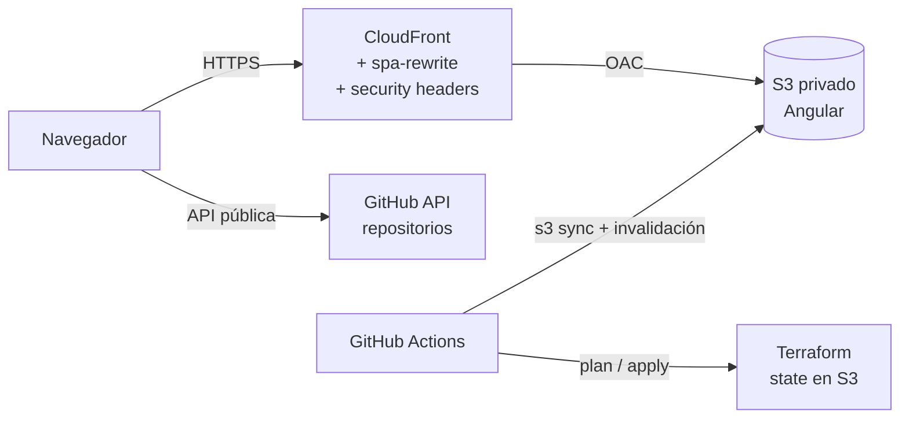

# Portafolio – Mario Araya Lecaros

Portafolio personal en **Angular 22**, publicado en **AWS (S3 + CloudFront)**, con la infraestructura
definida en **Terraform** y desplegada con **GitHub Actions**. Sigue la misma estructura y prácticas
que [tareas-aws](https://github.com/marioal1990/tareas-aws).

---

## Índice

1. [Arquitectura](#1-arquitectura)
2. [Estructura del repositorio](#2-estructura-del-repositorio)
3. [Conceptos que necesitas conocer](#3-conceptos-que-necesitas-conocer)
4. [Requisitos previos](#4-requisitos-previos)
5. [Puesta en marcha paso a paso](#5-puesta-en-marcha-paso-a-paso)
6. [Trabajo diario](#6-trabajo-diario)
7. [Solución de problemas](#7-solución-de-problemas)
8. [Anexo: crear el state y los usuarios de Terraform](#8-anexo-crear-el-state-y-los-usuarios-de-terraform)
9. [Costos y eliminación](#9-costos-y-eliminación)

---

## 1. Arquitectura



- El visitante entra por **CloudFront**, que entrega el sitio por HTTPS desde un **bucket S3 privado**.
  Nadie puede leer el bucket directamente: solo CloudFront, mediante **OAC** (Origin Access Control).
- La sección de proyectos consulta en vivo la **API pública de GitHub** desde el navegador.
- **GitHub Actions** crea la infraestructura con Terraform y publica cada versión del sitio.

| Recurso | Archivo |
|---|---|
| Bucket S3 privado, cifrado, sin ACLs | `infra/s3.tf` |
| CloudFront con OAC, HTTP/3, headers de seguridad y función `spa-rewrite` | `infra/cloudfront.tf` |
| Usuario `github-deploy-portafolio` (mínimo privilegio) | `infra/iam.tf` |
| State en `tareas-tfstate-mario-2026`, key `portafolio/` | `infra/versions.tf` |

---

## 2. Estructura del repositorio

```
portafolio/
├── frontend/                       Angular
│   └── src/app/data/cv.ts            todo el contenido del sitio (textos, experiencia, stack)
├── infra/                          Terraform
│   ├── versions.tf                   versión de Terraform, provider AWS y dónde se guarda el state
│   ├── variables.tf                  región, nombre del bucket, etc.
│   ├── s3.tf  cloudfront.tf  iam.tf  recursos de AWS
│   ├── outputs.tf                    valores que muestra Terraform al terminar
│   └── cloudfront/spa-rewrite.js     función que envía las rutas de Angular a index.html
└── .github/workflows/
    ├── terraform.yml                 crea o modifica la infraestructura
    └── deploy-frontend.yml           compila Angular y lo sube a S3
```

---

## 3. Conceptos que necesitas conocer

| Concepto | Qué es aquí |
|---|---|
| **Terraform** | Herramienta que crea la infraestructura de AWS a partir de los archivos `.tf`. No necesitas instalarla: la ejecuta GitHub Actions. |
| **State** | Archivo donde Terraform recuerda qué creó. Vive en el bucket `tareas-tfstate-mario-2026`, compartido con tareas-aws, pero en otra carpeta (`portafolio/`). |
| **Plan / Apply** | *Plan* muestra qué va a cambiar, sin tocar nada. *Apply* aplica esos cambios. |
| **Usuario IAM técnico** | Usuario de AWS que no es una persona: lo usa GitHub Actions. Se autentica con un par de *access keys*. |
| **Access key** | Par `AWS_ACCESS_KEY_ID` + `AWS_SECRET_ACCESS_KEY`. AWS muestra el secret **una sola vez**, al crearlo. |
| **Secret de GitHub** | Valor cifrado que solo los pipelines pueden leer. Una vez guardado, nadie puede volver a verlo, solo reemplazarlo. |
| **Variable de GitHub** | Valor no secreto (nombre del bucket, ID de la distribución), visible en la configuración del repo. |

Este proyecto usa **tres usuarios técnicos**:

| Usuario IAM | Lo crea | Para qué |
|---|---|---|
| `github-terraform-plan` | tareas-aws | Ejecutar el *plan* (solo lectura) |
| `github-terraform-apply` | tareas-aws | Ejecutar el *apply* (administrador) |
| `github-deploy-portafolio` | **este proyecto** (paso 5.4) | Subir el sitio a S3 e invalidar CloudFront |

> `github-deploy-portafolio` **no se crea a mano**: lo crea Terraform en el paso 5.4. Si lo creas
> desde la consola, Terraform fallará después con `EntityAlreadyExists`.

---

## 4. Requisitos previos

**Cuentas**

- Una cuenta de **AWS** con acceso a la consola.
- Una cuenta de **GitHub**.

**En tu computador**

- **Git**. En macOS se instala solo la primera vez que ejecutas `git` en la terminal.
- **Opcional:** [GitHub CLI](https://cli.github.com) (`gh`) y [AWS CLI](https://aws.amazon.com/cli/).
  Todo se puede hacer desde las páginas web de GitHub y AWS; las alternativas por terminal se indican en cada paso.
- **Opcional, solo para probar el sitio en local:** Node.js 22.

**En AWS (ya existen si levantaste tareas-aws)**

- El bucket `tareas-tfstate-mario-2026`.
- Los usuarios IAM `github-terraform-plan` y `github-terraform-apply`, con sus access keys.

Para comprobarlo, entra a la consola de AWS (región **Ohio, us-east-2**):

- *S3* → debe aparecer `tareas-tfstate-mario-2026`.
- *IAM → Users* → deben aparecer `github-terraform-plan` y `github-terraform-apply`.

Si alguno no existe, sigue primero el [Anexo](#8-anexo-crear-el-state-y-los-usuarios-de-terraform).

---

## 5. Puesta en marcha paso a paso

Haz los pasos **en orden**. Cada uno indica cómo comprobar que salió bien antes de seguir.

### 5.1 Ajustar el contenido

1. Abre `frontend/src/app/data/cv.ts`.
2. Reemplaza `linkedinUrl` por la URL de tu perfil de LinkedIn.
3. Revisa los textos de experiencia y stack.

### 5.2 Crear el repositorio en GitHub y subir el código

1. En GitHub: botón **+** (arriba a la derecha) → **New repository**.
2. *Repository name*: `portafolio`. Déjalo **vacío**: sin README, sin `.gitignore` y sin licencia.
3. Pulsa **Create repository**.
4. En la terminal, dentro de la carpeta `portafolio` del proyecto:

   ```bash
   git init
   git add .
   git commit -m "Portafolio inicial"
   git branch -M main
   git remote add origin https://github.com/marioal1990/portafolio.git
   git push -u origin main
   ```

   Si Git pide contraseña, no sirve la de tu cuenta: inicia sesión con `gh auth login` o usa un
   *personal access token*.

**Comprobación:** en la pestaña **Actions** del repo aparecen dos ejecuciones en rojo, *Terraform (infra)*
y *Deploy Portafolio*. **Es lo esperado:** todavía faltan los secrets y la infraestructura.

### 5.3 Cargar los secrets de Terraform

Son las **mismas keys** que usa tareas-aws.

1. En el repo: **Settings → Secrets and variables → Actions**.
2. Pestaña **Secrets** → **New repository secret**. Crea estos cuatro (el nombre debe ser exacto):

   | Name | Secret |
   |---|---|
   | `TF_PLAN_AWS_ACCESS_KEY_ID` | Access key ID de `github-terraform-plan` |
   | `TF_PLAN_AWS_SECRET_ACCESS_KEY` | Secret access key de `github-terraform-plan` |
   | `TF_APPLY_AWS_ACCESS_KEY_ID` | Access key ID de `github-terraform-apply` |
   | `TF_APPLY_AWS_SECRET_ACCESS_KEY` | Secret access key de `github-terraform-apply` |

**¿No tienes los valores?** No se pueden recuperar ni desde GitHub ni desde AWS. Hay que crear keys
nuevas y cargarlas **en los dos repos**, tareas-aws y portafolio:

1. AWS → *IAM → Users → github-terraform-plan → Security credentials*.
2. En *Access keys*: si ya hay **2**, borra la que no uses (*Actions → Deactivate* y luego *Delete*).
   AWS permite un máximo de 2 por usuario.
3. **Create access key** → *Application running outside AWS* → *Next* → **Create access key**.
4. Pulsa **Download .csv file** y guárdalo en un lugar seguro (por ejemplo, un gestor de contraseñas).
5. Repite con `github-terraform-apply`.
6. Actualiza los cuatro secrets en **ambos** repos.
7. Cuando el pipeline de tareas-aws funcione con las keys nuevas, borra las antiguas.

Con GitHub CLI puedes cargarlos en los dos repos de una vez:

```bash
for repo in marioal1990/tareas-aws marioal1990/portafolio; do
  gh secret set TF_PLAN_AWS_ACCESS_KEY_ID      -R $repo -b "AKIA..."
  gh secret set TF_PLAN_AWS_SECRET_ACCESS_KEY  -R $repo -b "..."
  gh secret set TF_APPLY_AWS_ACCESS_KEY_ID     -R $repo -b "AKIA..."
  gh secret set TF_APPLY_AWS_SECRET_ACCESS_KEY -R $repo -b "..."
done
```

**Comprobación:** en *Settings → Secrets and variables → Actions → Secrets* aparecen los cuatro nombres.

### 5.4 Crear la infraestructura con Terraform

1. En el repo: pestaña **Actions**.
2. En la lista de la izquierda, elige **Terraform (infra)**.
3. A la derecha, botón **Run workflow**:
   - *Branch*: `main`
   - Marca la casilla **Aplicar los cambios (terraform apply)**.
   - Pulsa el botón verde **Run workflow**.
4. Se ejecutan dos trabajos: **Plan** (unos 30 segundos) y luego **Apply** (5 a 10 minutos, porque
   CloudFront tarda en desplegarse en todo el mundo).
5. Antes de que termine el Apply, revisa el resumen del **Plan**: debe decir algo como
   `Plan: 11 to add, 0 to change, 0 to destroy`. Si dice *destroy* o *replaced*, cancela la ejecución
   y revisa qué cambió.

> En esta ejecución manual el *plan* usa el usuario de apply, porque `github-terraform-plan` aún no
> tiene permiso sobre la carpeta `portafolio/` del state. Ese permiso lo crea este mismo apply; desde
> ahí, los push automáticos vuelven a usar el usuario de solo lectura.

6. Cuando termine en verde, abre el trabajo **Apply** → paso **Apply**. Al final del log verás:

   ```
   Outputs:

   cloudfront_distribution_id = "E1A2B3C4D5E6F7"
   s3_bucket = "portafolio-mario-2026"
   url = "https://d1abcdefghij.cloudfront.net"
   usuario_deploy = "github-deploy-portafolio"
   ```

   **Copia estos valores**: los necesitas en los pasos siguientes.

**Comprobación:** en AWS → *IAM → Users* ya aparece `github-deploy-portafolio`, y en *CloudFront*
aparece la distribución "Portafolio Mario Araya".

### 5.5 Crear las access keys del usuario de despliegue

Terraform no las crea a propósito: si lo hiciera, quedarían guardadas en el state.

1. AWS → *IAM → Users →* **github-deploy-portafolio**.
2. Pestaña **Security credentials** → sección *Access keys* → **Create access key**.
3. Caso de uso: **Application running outside AWS** → *Next*.
4. *Description tag* (opcional): `GitHub Actions portafolio` → **Create access key**.
5. Pulsa **Download .csv file**. El *Secret access key* no se vuelve a mostrar.

Con AWS CLI: `aws iam create-access-key --user-name github-deploy-portafolio`

### 5.6 Cargar las variables y secrets del despliegue

En el repo: **Settings → Secrets and variables → Actions**.

**Pestaña Variables** → *New repository variable*:

| Name | Value |
|---|---|
| `S3_BUCKET` | el `s3_bucket` del paso 5.4 |
| `CF_DIST_ID` | el `cloudfront_distribution_id` del paso 5.4 |

**Pestaña Secrets** → *New repository secret*:

| Name | Secret |
|---|---|
| `AWS_ACCESS_KEY_ID` | Access key ID del paso 5.5 |
| `AWS_SECRET_ACCESS_KEY` | Secret access key del paso 5.5 |

> Usa las keys de `github-deploy-portafolio`, **no** las de `github-deploy` de tareas-aws. Los secrets
> se llaman igual en los dos repos, pero cada usuario solo tiene permiso sobre sus propios recursos.

Con GitHub CLI:

```bash
gh variable set S3_BUCKET  -R marioal1990/portafolio -b "portafolio-mario-2026"
gh variable set CF_DIST_ID -R marioal1990/portafolio -b "E1A2B3C4D5E6F7"
gh secret set AWS_ACCESS_KEY_ID     -R marioal1990/portafolio -b "AKIA..."
gh secret set AWS_SECRET_ACCESS_KEY -R marioal1990/portafolio -b "..."
```

### 5.7 Publicar el sitio

1. **Actions → Deploy Portafolio → Run workflow** → *Branch* `main` → **Run workflow**.
2. Espera a que termine en verde (2 a 3 minutos).
3. Abre la `url` del paso 5.4.

**Comprobación:** se ve el portafolio, la sección *Proyectos en GitHub* carga tus repositorios, y al
recargar una ruta como `/proyectos` no aparece un error.

Listo. Desde ahora, cada `git push` con cambios en `frontend/` publica el sitio automáticamente.

---

## 6. Trabajo diario

### Cambiar el contenido del sitio

```bash
cd frontend
npm ci          # solo la primera vez
npm start       # vista previa en http://localhost:4200
```

Edita `src/app/data/cv.ts`, revisa el resultado en el navegador y luego:

```bash
git add .
git commit -m "Actualizar experiencia"
git push
```

El pipeline **Deploy Portafolio** publica el cambio. CloudFront puede tardar 1 o 2 minutos en reflejarlo.

### Cambiar la infraestructura

1. Edita los archivos de `infra/` y haz `git push`.
2. El pipeline **Terraform (infra)** ejecuta solo el **plan**. Revisa en el resumen qué va a cambiar.
3. Si está correcto: **Actions → Terraform (infra) → Run workflow → aplicar = true**.

| Pipeline | Se ejecuta | Qué hace |
|---|---|---|
| Deploy Portafolio | push con cambios en `frontend/`, o manual | Compila, sube a S3 (`index.html` sin caché, el resto con caché de 1 año) e invalida CloudFront |
| Terraform (infra) | push con cambios en `infra/` | Solo *plan* (no modifica nada) |
| Terraform (infra) | manual con *aplicar = true* | *Plan* + *apply* |

---

## 7. Solución de problemas

| Mensaje o síntoma | Causa | Solución |
|---|---|---|
| `Falta el secret ...` o `Falta la variable ...` | No está cargado o tiene otro nombre | Revisa el nombre exacto en *Settings → Secrets and variables* (pasos 5.3 y 5.6). |
| No aparece el botón **Run workflow** | El workflow no está en la rama principal | Comprueba que hiciste push a `main`. |
| `InvalidClientTokenId` o `SignatureDoesNotMatch` | Keys mal copiadas, borradas o desactivadas | Vuelve a crearlas y cargarlas (paso 5.3 o 5.5). Revisa que no queden espacios al copiar. |
| `AccessDenied` sobre `tareas-tfstate-mario-2026/portafolio/...` en un push | Todavía no se ejecutó el primer apply | Ejecuta el paso 5.4. |
| `BucketAlreadyExists` | El nombre del bucket ya lo usa otra cuenta en el mundo | Cambia `bucket_nombre` en `infra/variables.tf` (por ejemplo `portafolio-mario-araya-2026`), haz push y repite el paso 5.4. |
| `EntityAlreadyExists: User ... github-deploy-portafolio` | El usuario se creó a mano | Bórralo en *IAM → Users* (primero sus access keys) y repite el paso 5.4. |
| `Error acquiring the state lock` | Otra ejecución de Terraform está corriendo o se cortó | Espera a que termine. Si se cortó, borra `portafolio/terraform.tfstate.tflock` del bucket de state. |
| `Saved plan is stale` | Algo cambió entre el plan y el apply | Ejecuta de nuevo el workflow con *aplicar = true*. |
| La URL muestra `AccessDenied` (XML) | El sitio aún no se publicó | Ejecuta el paso 5.7. |
| El sitio muestra la versión anterior | Caché del navegador | Recarga con Cmd + Shift + R. |
| "Proyectos en GitHub" muestra solo una selección | Límite de la API de GitHub (60 consultas por hora por IP) | Es temporal. Se usa la lista de respaldo de `cv.ts`. |

---

## 8. Anexo: crear el state y los usuarios de Terraform

Solo si **no** levantaste tareas-aws en esta cuenta de AWS. Todo se hace desde la consola, en la región **us-east-2 (Ohio)**.

### Bucket del state

1. *S3 → Create bucket*.
2. Nombre: `tareas-tfstate-mario-2026` (si cambias el nombre, actualízalo en `infra/versions.tf` y en `infra/variables.tf`).
3. Deja **Block all public access** activado.
4. En *Bucket Versioning*, elige **Enable**: si el state se daña, puedes volver a una versión anterior.
5. **Create bucket**.

### Usuario de plan (solo lectura)

1. *IAM → Users → Create user* → nombre `github-terraform-plan` → *Next*.
2. *Attach policies directly* → busca y marca **ReadOnlyAccess** → *Next* → **Create user**.
3. Entra al usuario → *Permissions → Add permissions → Create inline policy* → pestaña **JSON**:

   ```json
   {
     "Version": "2012-10-17",
     "Statement": [
       { "Effect": "Allow", "Action": "s3:ListBucket", "Resource": "arn:aws:s3:::tareas-tfstate-mario-2026" }
     ]
   }
   ```

   Nombre: `tfstate`. El permiso de escritura sobre `portafolio/` lo agrega Terraform en el paso 5.4.
4. Crea sus access keys como en el paso 5.5.

### Usuario de apply (administrador)

1. *IAM → Users → Create user* → nombre `github-terraform-apply`.
2. *Attach policies directly* → **AdministratorAccess** → **Create user**.
3. Crea sus access keys como en el paso 5.5.

> El usuario de apply tiene permisos amplios porque Terraform crea usuarios IAM, buckets y
> distribuciones. La protección está en el proceso: solo se usa cuando ejecutas el workflow a mano.

---

## 9. Costos y eliminación

**Costos:** S3 + CloudFront para un portafolio con poco tráfico queda dentro de la capa gratuita
(CloudFront incluye 1 TB de transferencia y 10 millones de solicitudes al mes). Aun así, mantén una
alerta de facturación en *Billing → Budgets*.

**Eliminar:** la distribución tiene `prevent_destroy` para no perder la URL por accidente. Para borrar todo:

1. Quita el bloque `lifecycle { prevent_destroy = true }` de `infra/cloudfront.tf`.
2. Vacía el bucket: *S3 → portafolio-mario-2026 → Empty*.
3. Borra las access keys de `github-deploy-portafolio` (*IAM → Users → Security credentials*).
4. Ejecuta `terraform destroy` desde la carpeta `infra/` (requiere Terraform instalado en tu equipo y
   credenciales de administrador).
