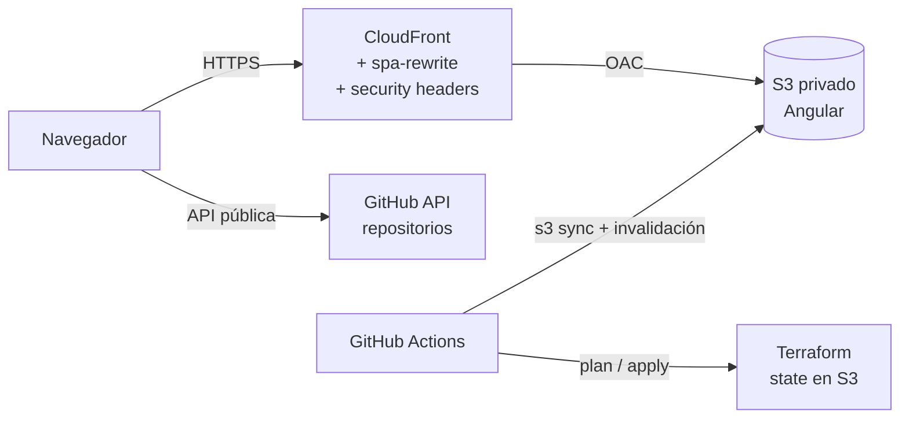

# Portafolio – Mario Araya Lecaros

Portafolio personal en **Angular 22**, publicado en **AWS (S3 + CloudFront)** con la infraestructura
definida en **Terraform** y desplegado con **GitHub Actions**. Sigue la misma estructura y prácticas
que [tareas-aws](https://github.com/marioal1990/tareas-aws).

## Arquitectura



| Recurso | Archivo |
|---|---|
| Bucket S3 privado, cifrado, sin ACLs | `infra/s3.tf` |
| CloudFront con OAC, HTTP/3, headers de seguridad y función `spa-rewrite` | `infra/cloudfront.tf` |
| Usuario `github-deploy-portafolio` (mínimo privilegio) | `infra/iam.tf` |
| State en `tareas-tfstate-mario-2026`, key `portafolio/` | `infra/versions.tf` |

## Estructura

```
portafolio/
├── frontend/                 Angular (contenido en src/app/data/cv.ts)
├── infra/                    Terraform
│   ├── versions.tf  variables.tf  outputs.tf
│   ├── s3.tf  cloudfront.tf  iam.tf
│   └── cloudfront/spa-rewrite.js
└── .github/workflows/
    ├── terraform.yml         plan automático, apply manual
    └── deploy-frontend.yml   build + S3 + invalidación
```

## Desarrollo local

```bash
cd frontend
npm ci
npm start      # http://localhost:4200
```

Para cambiar textos, experiencia o stack: `frontend/src/app/data/cv.ts`.
Pon ahí tu URL real de LinkedIn (`linkedinUrl`).

## Levantar la infraestructura (primera vez)

Requisitos: Terraform 1.16.x y AWS CLI configurada con un usuario administrador.

> La **primera** ejecución se hace desde tu equipo: el usuario `github-terraform-plan` todavía no
> tiene acceso al prefijo `portafolio/` del state; ese permiso lo crea este mismo `apply`.

```bash
cd infra
terraform init
terraform plan
terraform apply
terraform output      # url, cloudfront_distribution_id, s3_bucket
```

Si el nombre `portafolio-mario-2026` ya está tomado (los buckets son únicos a nivel mundial),
cámbialo en `variables.tf` o con `-var bucket_nombre=otro-nombre`.

### Access keys del usuario de despliegue

No se crean con Terraform para que no queden en el state:

```bash
aws iam create-access-key --user-name github-deploy-portafolio
```

## Configurar GitHub

Crea el repositorio `portafolio`, sube este proyecto y en **Settings → Secrets and variables → Actions**:

**Variables**

| Nombre | Valor |
|---|---|
| `S3_BUCKET` | `terraform output -raw s3_bucket` |
| `CF_DIST_ID` | `terraform output -raw cloudfront_distribution_id` |

**Secrets**

| Nombre | Valor |
|---|---|
| `AWS_ACCESS_KEY_ID` / `AWS_SECRET_ACCESS_KEY` | keys de `github-deploy-portafolio` |
| `TF_PLAN_AWS_ACCESS_KEY_ID` / `TF_PLAN_AWS_SECRET_ACCESS_KEY` | las mismas que usas en tareas-aws |
| `TF_APPLY_AWS_ACCESS_KEY_ID` / `TF_APPLY_AWS_SECRET_ACCESS_KEY` | las mismas que usas en tareas-aws |

## Pipelines

- **Deploy Portafolio**: cada push con cambios en `frontend/` compila, sube a S3
  (`index.html` sin caché, el resto con caché de 1 año) e invalida CloudFront.
  También se puede ejecutar a mano desde *Actions*.
- **Terraform (infra)**: cada push con cambios en `infra/` ejecuta solo el *plan*.
  Para aplicar: *Actions → Terraform (infra) → Run workflow → aplicar = true*.

## Costos

S3 + CloudFront para un portafolio con poco tráfico queda dentro de la capa gratuita
(CloudFront incluye 1 TB de transferencia y 10 millones de solicitudes al mes).

## Eliminar

La distribución tiene `prevent_destroy` para no perder la URL por accidente. Para borrar todo:
quita ese bloque `lifecycle`, vacía el bucket (`aws s3 rm s3://portafolio-mario-2026 --recursive`)
y ejecuta `terraform destroy`.
